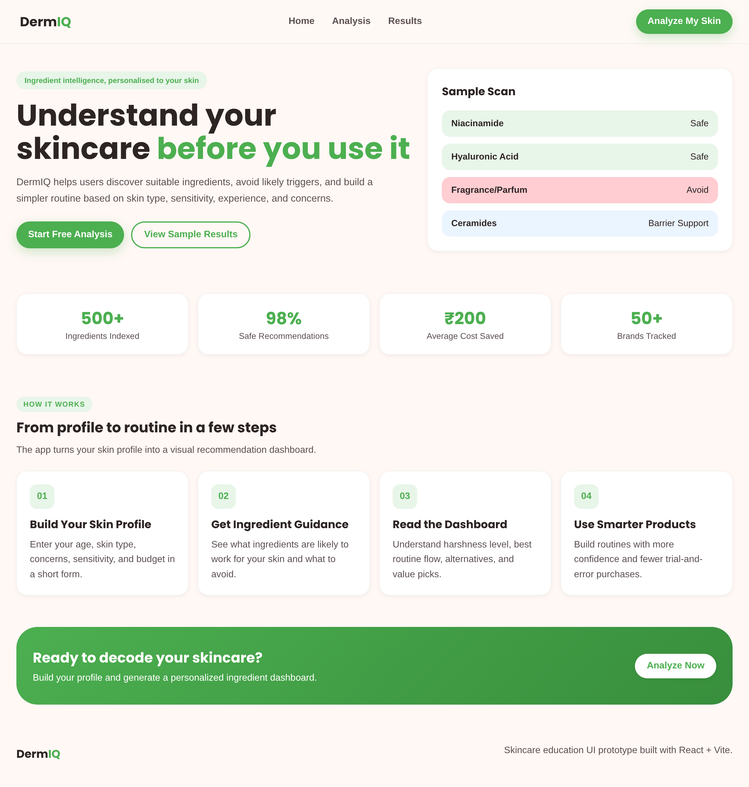
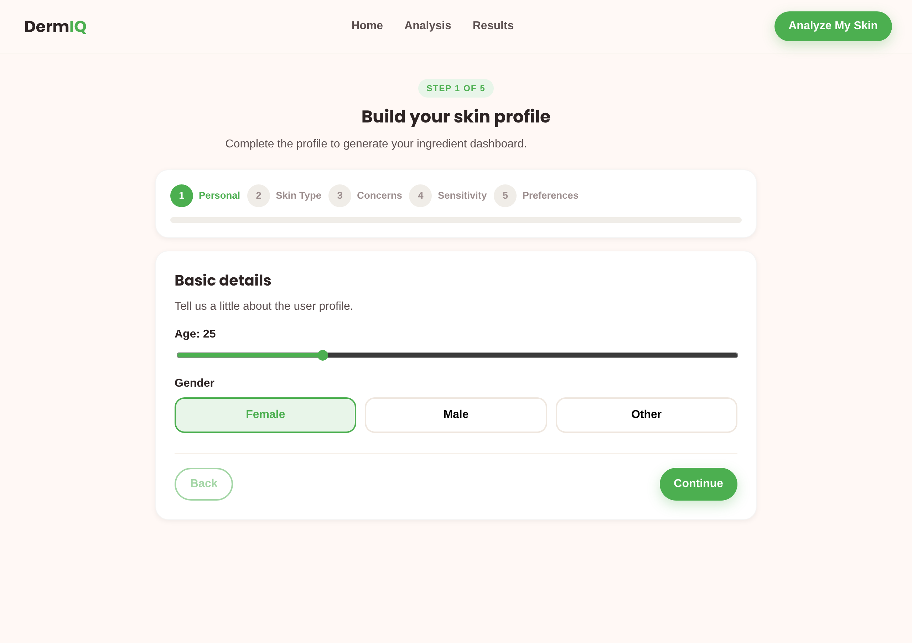
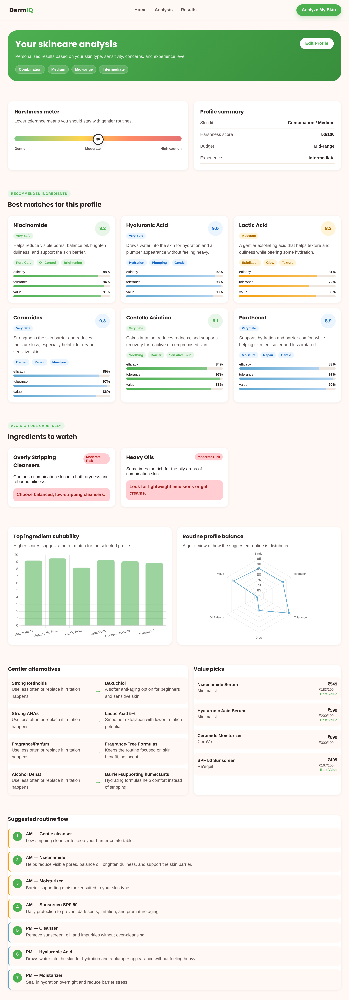

# DermIQ — Skincare Ingredient Intelligence

DermIQ turns a short skin profile into a clear, personalised ingredient breakdown: what's likely to suit your skin, what to be cautious with, a gentler alternative for each harsh active, value-for-money product picks, and a simple AM/PM routine. It pairs a **React web app** with a **Tableau dashboard** that explores the underlying ingredient data.

> **How the recommendations work (plainly):** DermIQ uses a transparent, rule-based engine — not a black-box model. Recommendations come from a curated ingredient knowledge base combined with the user's skin type, sensitivity, concerns, and experience level. Every suggestion is traceable to a rule, which is deliberate: for a skincare tool, an explainable "why" matters more than an opaque score. See [Roadmap](#roadmap) for where a learned model would add value.

---

## Demo

🔗 **Live demo:** _add your deployed link here_ (see [Deploy](#deploy))

| Home | Analysis form | Results dashboard |
| --- | --- | --- |
|  |  |  |

**Tableau dashboard preview:** _export an image of the dashboard to `screenshots/dashboard.png` and reference it here._

---

## Features

**Web app**
- **Skin profile form** — age, gender, skin type, concerns, sensitivity, budget, experience.
- **Recommended ingredients** — matched to the profile, each with a safety rating, benefit summary, tags, and efficacy / tolerance / value bars.
- **Ingredients to watch** — likely triggers for the profile, with the reason and a usage warning.
- **Harshness meter** — a 10–95 score estimating how cautious the routine should be, derived from sensitivity, experience, and skin type.
- **Profile-driven charts** — a suitability bar chart and a six-axis radar (Barrier, Hydration, Tolerance, Glow, Oil Balance, Value), both computed from the matched ingredients.
- **Gentler alternatives** — a softer swap for each harsh active (e.g. Bakuchiol for strong retinoids).
- **Value picks & routine** — cost-effective product suggestions and a step-by-step AM/PM flow.

**Tableau dashboard (`dermIQ.twb`)**
- Overall summary (ingredients analysed, average safety score, ingredients to avoid, best-value picks)
- Ingredient safety scores
- Skin-type harshness heatmap
- Ingredient distribution by skin type
- Price vs. efficacy

---

## Tech stack

| Layer | Tools |
| --- | --- |
| Frontend | React 18, Vite 5 |
| Charts | Chart.js 4, react-chartjs-2 |
| Logic | Plain JavaScript rule engine (`src/utils/buildAnalysis.js`) |
| Data | Curated ingredient dataset (`src/data/*.js`) |
| Analytics | Tableau |

---

## Getting started

```bash
# 1. Install dependencies
npm install

# 2. Run the dev server
npm run dev

# 3. Build for production
npm run build
npm run preview
```

Then open the Tableau workbook `dermIQ.twb` in Tableau Desktop / Public to explore the data side.

---

## Deploy

This is a static Vite build, so it hosts free on any of these. **Vercel** is the quickest:

1. Push this repo to GitHub.
2. Go to [vercel.com](https://vercel.com), sign in with GitHub, and import the repo.
3. Vercel auto-detects Vite — framework **Vite**, build command `npm run build`, output `dist`. Click **Deploy**.
4. You get a live URL (e.g. `dermiq.vercel.app`) that redeploys automatically on every push.

**Netlify** works the same way (build `npm run build`, publish directory `dist`). For **GitHub Pages**, set `base: '/<repo-name>/'` in `vite.config.js` and deploy the `dist` folder via a GitHub Actions workflow.

Paste the final URL into the **Live demo** line above.

---

## Project structure

```
src/
├── App.jsx                 # Page routing (home / form / results) via state
├── components/
│   ├── Navbar.jsx
│   ├── HomePage.jsx
│   ├── AnalysisForm.jsx    # Collects the skin profile
│   ├── ResultsPage.jsx     # Renders the full analysis
│   ├── ResultsCharts.jsx   # Bar + radar charts (profile-driven)
│   └── Footer.jsx
├── data/
│   ├── ingredients.js      # Ingredient DB, details, avoid lists
│   ├── concerns.js         # Concern → ingredient mapping
│   ├── alternatives.js     # Harsh → gentle swaps
│   └── costs.js            # Value-for-money product data
├── utils/
│   └── buildAnalysis.js    # Core rule engine: profile → analysis
└── styles/
    └── index.css
```

---

## Roadmap

Honest next steps to deepen the project:

- **Deploy a live demo** and add real screenshots to this README.
- **Expand the ingredient dataset** and source it from a CSV so the web app and Tableau share one dataset.
- **Add a learned recommendation layer** — e.g. train a model on ingredient/skin-type compatibility and compare its output against the rule engine, so the rules become a baseline rather than the whole system.
- **Ingredient-list parser** — let users paste a product's INCI list and flag concerns directly.
- **Persistence** — save profiles and routines (localStorage or a small backend).
- **Tests** — unit tests for `buildAnalysis` covering each skin type and concern.

---

## Notes & limitations

DermIQ is an educational prototype, not medical advice. Ingredient ratings and product prices are curated for demonstration and should be verified against current, authoritative sources before any real purchasing decision.
